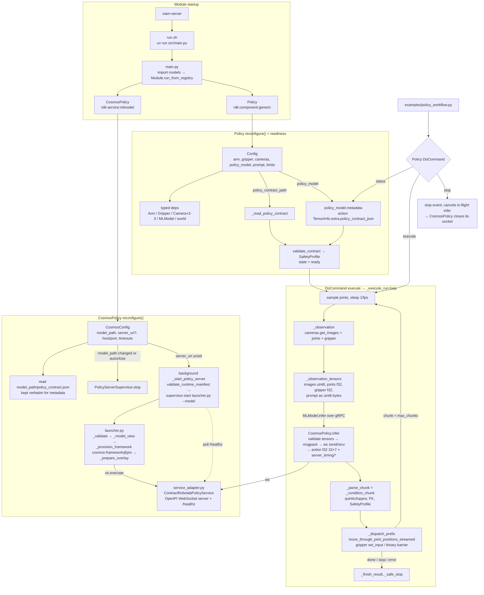

# arm-policy code flow

Two resources in one module: `viam-labs:arm-policy:cosmos` (`rdk:service:mlmodel`, `src/models/cosmos_policy.py`) serves a Cosmos action policy; `viam-labs:arm-policy:policy` (`rdk:component:generic`, `src/models/policy.py`) is the controller that drives the arm and gripper from it.

## Stages

| Stage | Files | Notes |
|---|---|---|
| Startup | `run.sh`, `src/main.py`, `src/models/__init__.py` | Importing both `EasyResource` classes registers them; `Module.run_from_registry()` serves them. |
| MLModel config / lifecycle | `src/models/cosmos_policy.py`, `src/models/model_export.py`, `src/models/policy_server.py` | `reconfigure` validates `model_path`, reads the contract, and (unless `server_uri` is set) starts the managed server in the background. A `model_path` change stops the old server first. The MLModel API has no DoCommand. |
| Policy server | `policy_server_runtime/launcher.py`, `policy_server_runtime/service_adapter.py` | Launcher provisions the pinned `cosmos-framework`, builds a symlinked model view (keyed by package path + config), applies the joint-width patch, then `execvpe`s the adapter, which serves OpenPI WebSocket (msgpack) with guardrails disabled. |
| Tensor contract | `src/models/wire.py` | Tensor names, msgpack framing, `prompt` ↔ uint8 bytes, `CONTRACT_EXTRA` key for the contract in `metadata()`. |
| Controller readiness | `src/models/policy.py` (`_advance_readiness`) | Contract from `policy_contract_path` (sync, at reconfigure) or from `policy_model.metadata()` (on first `status`/`execute`). Cross-checked against config limits via `validate_contract`. |
| Execute loop | `src/models/policy.py` (`_execute_run`, `_infer`), `src/models/trajectory_conditioner.py` | Per chunk: observation → tensors → `MLModel.infer` → `{action, server_timing}` → conditioning/validation → bounded prefix to hardware. `stop` cancels the in-flight infer; the service closes its WebSocket on any torn exchange. |
| Replay | `src/models/replay_source.py` | Recorded chunks stand in for the model; needs only `policy_contract_path`. |

## DoCommand surface

- `viam-labs:arm-policy:policy`: `execute`, `stop`, `status`.
- `viam-labs:arm-policy:cosmos`: none (MLModel API: `Infer`, `Metadata`).
