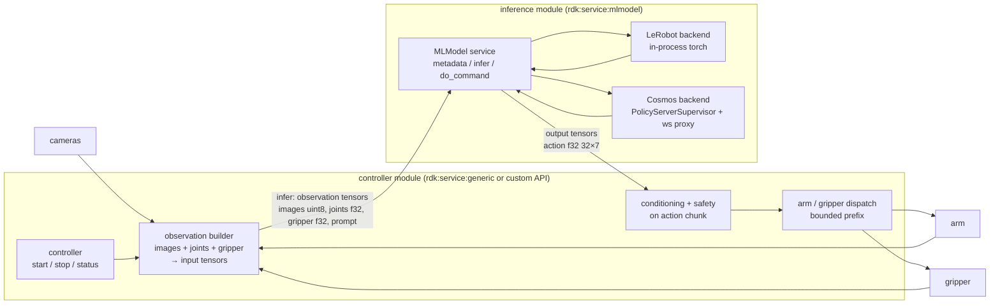

# Design: split arm-policy into an `rdk:service:mlmodel` policy and a controller

Status: implemented in this repo on branch `vp/mlmodel-split` (`src/models/cosmos_policy.py`, `src/models/wire.py`, controller changes in `src/models/policy.py`). Evidence refs are against this repo, `vla-inference-service`, viam-sdk 0.83/0.84, and `rdk` e1e07b1b0. Corrections found during implementation are marked **Implemented**.

## Problem

`Policy` (`src/models/policy.py`) bundles three concerns in one `rdk:component:generic`:

1. Model lifecycle — `ModelStore` download, `PolicyServerSupervisor` spawning the Cosmos side-car, readiness.
2. Inference transport — persistent WebSocket to `server_uri`, msgpack framing (`_connect`, `_recv`, `_wire_observation`, `_parse_chunk`).
3. Control — observation capture with joint-history timing, `_condition_chunk` (quintic/toppra, FK, `SafetyProfile`), `_dispatch_prefix` streaming to arm/gripper.

`vla-inference-service` already has the 2-service shape (`VLAPolicy` ↔ `VLAController` over DoCommand) but with an in-process LeRobot backend and a different control loop. Two controllers, two policy protocols, no shared contract.

## Target

- The mlmodel service owns model lifecycle + inference transport. The Cosmos backend is a thin proxy: the upstream server is stateless per request (`RobolabPolicyService.infer`, history rows are supplied by the client; `history_length=1` + `use_state`).
- The controller owns everything in today's `_execute_run` except L1674–1690 (send/recv), which becomes `await mlmodel.infer(tensors)`.
- Safety limits move to controller config: they are embodiment properties (Lite6 vs UR20), not model properties.

Why split into modules rather than one module with two services: inference needs GPU + torch/cosmos-framework; the controller needs only the SDK. Separate modules let the controller run on the robot part and the mlmodel on a GPU part via a Viam remote — which is what `server_uri` is doing by hand today.

## Tensor contract (Cosmos backend)

| Direction | Name | dtype | shape | Source today |
|---|---|---|---|---|
| in | `observation/wrist_image_left` | uint8 | `[480,640,3]` | `_decode_image(wrist)` |
| in | `observation/exterior_image_1_left` | uint8 | `[720,1280,3]` | `_decode_image(fixed)` |
| in | `observation/exterior_image_2_left` | uint8 | `[720,1280,3]` | `_decode_image(fixed_2)` or fixed |
| in | `observation/joint_position` | float32 | `[6]` | `_joint_radians` |
| in | `observation/gripper_position` | float32 | `[1]` | `_gripper_input`, `[0,1]` |
| in | `prompt` | uint8 | `[-1]` | UTF-8 bytes; see hurdle 1 |
| out | `action` | float32 | `[32,7]` | `ACTION_SHAPE` |
| out | `server_timing/<key>` | float32 | `[1]` | optional; flattened from `server_timing` |

Payload ≈ 6.4 MB per chunk; RDK gRPC cap is `rpc.MaxMessageSize = 1<<25` (32 MB; `rdk/module/module.go:219`, `robot/web/web.go:442`). 4K or more than ~5 cameras would exceed it.

`undo_server_gripper_flip` (`_wire_observation` L1141, `_parse_chunk` L1165) moves into the backend so the mlmodel exposes clean `[0,1]` gripper semantics.

## Hurdles, ranked

### 1. viam-server drops `InferRequest.extra` (blocking; decide first)

The upstream server requires `prompt` as a string (`_build_sample`). The natural channel is `extra`, but every controller → mlmodel call is proxied through viam-server, whose Go implementation discards it:

- `rdk/services/mlmodel/mlmodel.go:70` — `Infer(ctx, tensors ml.Tensors)`; no `extra`.
- `rdk/services/mlmodel/server.go:27-48` — never reads `req.Extra`.
- `rdk/services/mlmodel/client.go:53` — outgoing request has no `Extra`.

A prototype with the Python client talking directly to the module would appear to work and then fail under a real robot config.

| Option | Tradeoff |
|---|---|
| `prompt` as uint8 UTF-8 tensor `[-1]`, declared in `metadata()` with `TensorInfo.extra={"encoding":"utf-8"}` | Survives the proxy; `infer` stays stateless/atomic. Unidiomatic. **Recommended.** |
| `do_command({"command":"set_prompt"})` before `execute` | Stateful side channel; races with multiple clients. |
| Prompt as mlmodel config attr | Task change = reconfigure = policy server restart. Worst. |

Same applies to any future per-call scalar (RTC params for LeRobot): tensors or nothing.

### 2. Contract / `SafetyProfile` ownership (design seam)

Today `Policy.reconfigure` → `_advance_readiness` → `_contract_path` → `ModelStore.get` reads `policy_contract.json` from the model record and derives `SafetyProfile`; `validate_contract` cross-checks config limits against it. Once the mlmodel owns `model_source`/`ModelStore`, the controller has no record path.

`Metadata` has only `name/type/description/input_info/output_info`; shapes fit, the rest (`action_chunk_size`, `conditioning_fps`, `gripper_mode`, embodiment) does not. Safety limits themselves become controller config regardless.

**Implemented:** the MLModel API has **no `DoCommand` RPC** at all (`MLModelService` = `Infer`, `Metadata`, `GetStatus`; viam-sdk `mlmodel_grpc.py`), so the `do_command` route proposed above does not exist. The contract is published verbatim as `TensorInfo.extra["policy_contract_json"]` on the `action` output (`wire.CONTRACT_EXTRA`), which RDK round-trips (`rdk/services/mlmodel/mlmodel.go:307-311`, `client.go:107`). The controller fetches it with `metadata()` on the first `status`/`execute` after reconfigure. The same absence of `DoCommand` means `policy_server start/stop/status` cannot be exposed on the service: the server is started from `reconfigure` (background task), stopped when `model_path` changes or on `policy_server_autoclose`, and its state is surfaced in `Infer` errors. This also closes review item B1 (stale server after a package bump).

### 3. Cancellation and single-flight

- `_stop_command` currently closes the WebSocket to abort `_recv`. With gRPC, `stop` cancels the in-flight `infer()` task; grpclib cancels the stream → viam-server ctx cancel → module. The backend must close its socket on `CancelledError`, otherwise the next `infer` reads the stale response frame (openpi protocol is strict request/response per connection, with a metadata frame on connect — `_connect` L1127-1135).
- Upstream `infer` holds `self._lock` and runs `generate_samples_from_batch` to completion regardless. No worse than today.
- Backend needs one persistent socket + `asyncio.Lock`, or connect-per-call. Concurrent callers must serialize.

### 4. One controller, two execution models (the real decision)

arm-policy: chunk → condition (quintic/toppra, FK, `SafetyProfile`) → stream a validated prefix via `move_through_joint_positions_streamed`.
vla-inference-service: 10 Hz tick with `ActionQueue`/`AsyncScheduler` and a per-tick delta clamp.

Different control philosophies. Either the controller grows a `mode` (chunk-prefix vs tick-scheduler) or one is chosen and the other's safety ideas are ported. This determines whether the merge is a week or a month. Do not split into two modules before this is decided.

### 5. Mechanical

- Readiness: no `status` in the MLModel API. `metadata()`/`infer()` raise until `PolicyServerSupervisor` is healthy; `policy_server start/stop/status` and `models/*` move to the mlmodel's `do_command`.
- `server_metadata`/`server_timing` in `RunStatus` (L1610, L1717-1719): output tensors are numeric only — flatten or drop.
- Joint-history timing (`_joint_sampled_at_monotonic` in `_observation`) is controller logic; unaffected.
- Each hop converts proto ↔ gorgonia tensor in viam-server; tens of ms vs multi-second inference.

## Sequencing

1. **Done:** mlmodel side — `CosmosPolicy` proxy with `metadata()` (contract in `TensorInfo.extra`), `infer()` (prompt as uint8 tensor, socket closed on any torn exchange), server lifecycle from `reconfigure`.
2. **Done:** controller in this repo stays Generic; `_execute_run` calls `MLModel.infer` through the `policy_model` dependency. Verified end-to-end through the real Python SDK gRPC server/client and a fake OpenPI WebSocket server, including `stop` cancelling an in-flight infer.
3. Resolve hurdle 4 against `vla-inference-service`'s controller.
4. Only then cut the controller out into its own module.

Naming: the inference module is a policy (observation → action chunk) — e.g. `vla-policy` with models `:lerobot` / `:cosmos`, and `vla-controller`. Avoid "action service"; Viam already overloads "action".
